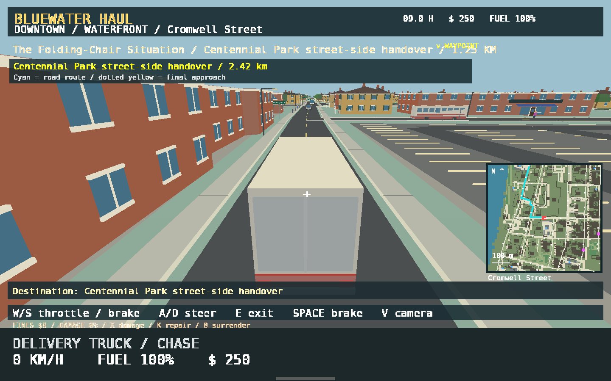
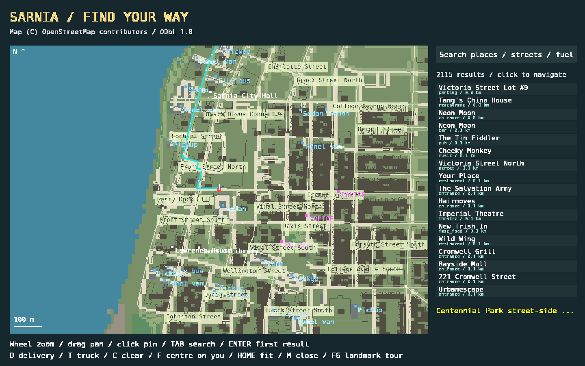
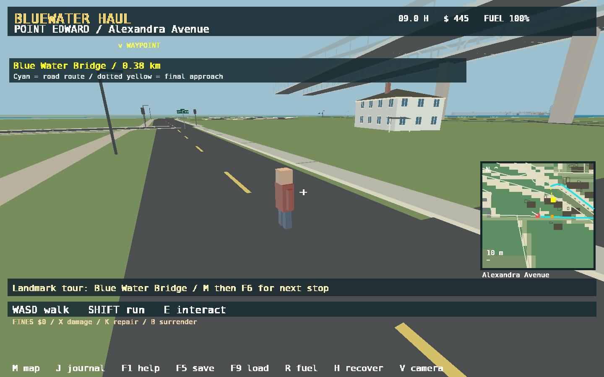
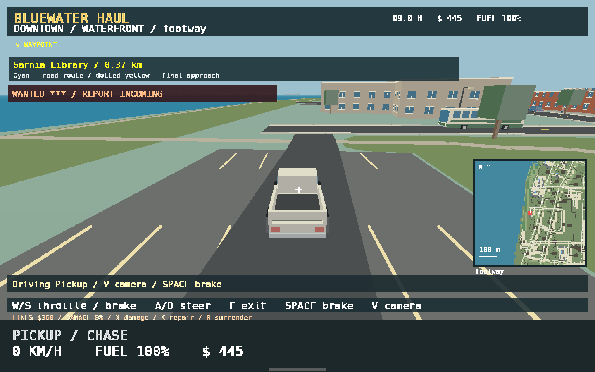
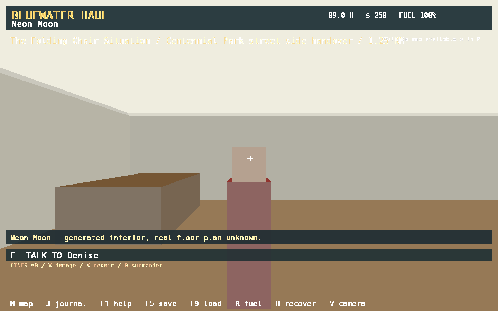

# Bluewater Haul

**A small-town Canadian trucking and neighbourhood RPG — Sarnia prototype v0.7**

Drive a delivery truck through a recognizable OpenStreetMap-derived Sarnia,
Ontario, take on wonderfully impractical delivery jobs, get out and explore,
enter simplified buildings, try other vehicles, and encounter local street
life and a working (prototype) police response.

Built with **C#**, **.NET 8** and **MonoGame DesktopGL 3.8.4.1**. The game code,
models, NPCs, dialogue, and contracts are original; map features come from an
attributed OpenStreetMap extract. **This is a work-in-progress vertical slice,
not a completed city or driving simulator.**



## Screenshots

| Explore the real street layout | Cross the Blue Water Bridge area |
|:---:|:---:|
|  |  |
| **Drive different vehicles** | **Enter generated interiors** |
|  |  |

## Play

1. On a published GitHub version, open **Releases** and download the Windows
   x64 ZIP asset (`BluewaterHaul-...-win-x64.zip`). A ZIP is produced by the
   workflow when a `v*` tag is pushed; source-only downloads are not playable.
2. Extract the **entire** archive; do not run the game from inside the ZIP.
3. Run `BluewaterHaul.exe` from its extracted directory. Keep the `Data`
   directory with the executable.
4. Close the welcome/help screen with **F1**. Your first load is already aboard:
   press **M** to find its gold marker and the cyan street route.

**System requirements:** Windows x64 and working OpenGL graphics drivers. The
published self-contained build includes the needed .NET runtime. Performance
will depend on your system and map rendering. No installer or Microsoft account
is required.

You can also run from source on Windows, Linux or macOS with a working DesktopGL
setup (see below). Only **Windows x64** is packaged for releases.

## Gameplay at a glance

- Drive the truck, or explore in parked **cars, pickups, vans and buses**.
- Deliver fictional cargo to five street-side destinations, earn money, and
  refuel at mapped fuel stations.
- Walk around and enter approximate doorways in Canadian-side buildings;
  discover procedural rooms and simple interactions.
- Explore real road alignments, named streets, building footprints, parks,
  waterfront areas and recognizable regional landmarks.
- Use a searchable, zoomable road map, minimap, waypoints and approximate
  routes with one-way handling.
- Encounter simulated road traffic, pedestrians with simple schedules,
  generated signals and reactions to theft, dangerous driving and vandalism.
- Experience lightweight damage, fire, explosions, police pursuits, recovery
  and persistent vehicle state — all intentionally simplified.

The world has *generated architecture and characters*, and the US side is
scenery only. Do not assume the represented businesses, roads, border access,
entrances or traffic signals are current, safe or accurate for real travel.
See [map fidelity and attribution](docs/MAP_AND_ACCURACY.md).

## Essential controls

| Key / input | Action |
| --- | --- |
| **W / S** | Accelerate / brake or reverse in vehicle; walk forward / back |
| **A / D** | Steer or strafe on foot |
| **Mouse / arrow keys** | Look around |
| **E** | Interact, enter/leave vehicles or buildings, talk, collect or deliver |
| **Space / Shift** | Service brake / handbrake (vehicle); Shift = sprint (walking) |
| **V** | Chase / first-person view outdoors |
| **Mouse wheel** | Chase camera distance; map zoom when map is open |
| **M** | Full searchable map, directions and waypoints |
| **J** | Dispatch / field journal |
| **F1** | In-game help |
| **F5 / F9** | Save / load |
| **Escape** | Close a panel, or save and exit when playing |

Full instructions, map interactions and less common controls:
[**Player guide**](docs/PLAYER_GUIDE.md).

## Build from source

You need the [.NET 8 SDK](https://dotnet.microsoft.com/download/dotnet/8.0)
(or a newer SDK capable of targeting .NET 8) and the native libraries and
OpenGL support required by MonoGame DesktopGL.

```sh
dotnet restore Source/SarniaPrototype.csproj
dotnet run --project Source/SarniaPrototype.csproj
```

There is **no MGCB project to build**: geometry is constructed in C#, the
bitmap atlas is in `Source/Data/`, and the compiled map data is tracked in the
repository. No Python installation is required to build or play.

Run data and game logic checks without opening a graphics window:

```sh
dotnet run --project Source/SarniaPrototype.csproj -- --verify
```

To publish a self-contained Windows ZIP, use the included GitHub Actions
workflow or follow [build & release instructions](docs/BUILD_AND_RELEASE.md).

## Repository guide

| Path | Purpose |
| --- | --- |
| `Source/` | Original C# game code and MonoGame project |
| `Source/Data/` | Required runtime world, locations, deliveries and font atlas |
| `MapSource/` | OpenStreetMap PBF source for rebuilding map content |
| `Source/Tools/` | Optional Python OSM import and content preparation scripts |
| `docs/` | Guides, architecture, geographic accuracy, screenshots and troubleshooting |
| `.github/workflows/` | CI checks and tag-triggered Windows release packaging |

For contributors: [architecture](docs/ARCHITECTURE.md) ·
[development and testing](docs/DEVELOPMENT.md) ·
[contribution guide](CONTRIBUTING.md) · [changelog](CHANGELOG.md).

## Save files

Saves and diagnostic crash text are placed at
`%LOCALAPPDATA%\BluewaterHaul\` on Windows (`save-v1.json`, `crash.txt`).
**Back up your save before experimenting with development versions.**
The optional graphical `--smoke` mode uses separate files in an ignored
`verification/` directory and will generate screenshots there.

## Licence and credits

Original project code: **© 2026 Michael Robinson — [MIT License](LICENSE)**.
Geographic database: **© OpenStreetMap contributors — ODbL 1.0**.
The font atlas, MonoGame and bundled runtimes have separate licenses;
read [third-party notices](THIRD_PARTY_NOTICES.md) before redistribution.

This is an original game, not a recreation of official municipal interiors or
representations of real people. Place descriptions are contextual references,
not endorsements.
